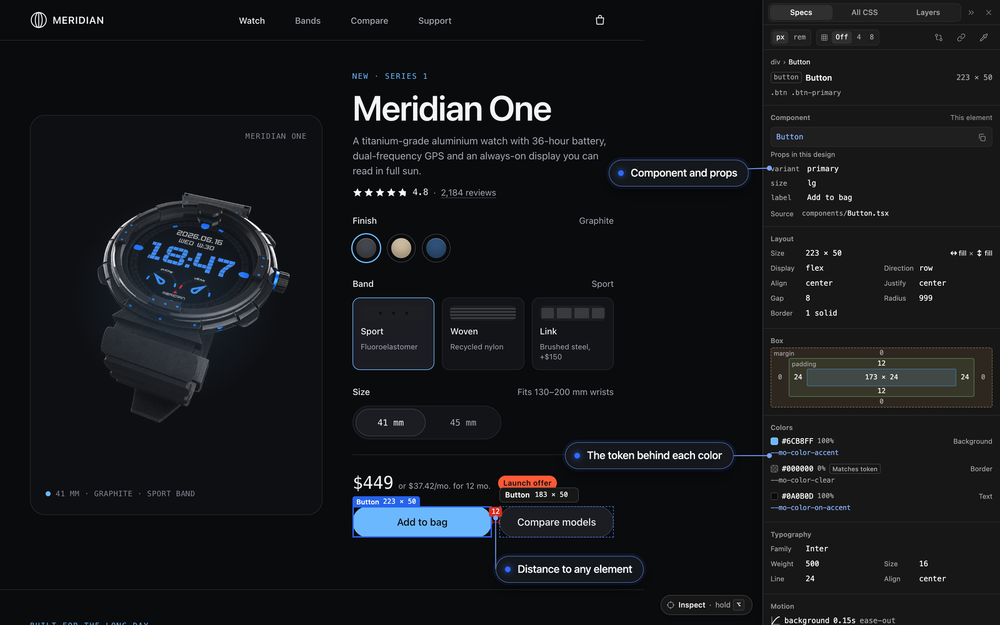
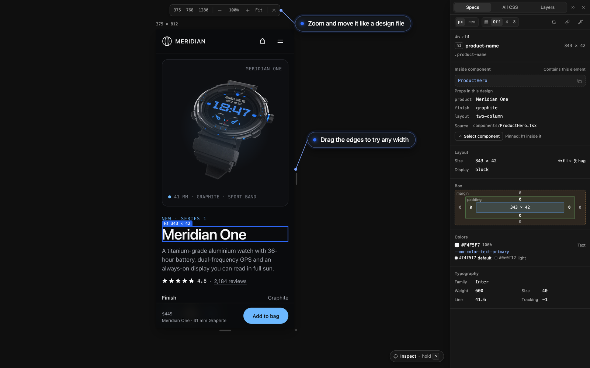

<h1>
  <picture>
    <source media="(prefers-color-scheme: dark)" srcset="docs/images/groma-logo-horizontal-dark.svg">
    
  </picture>
</h1>

Inspect any web page like a design file.

Groma is a Figma-style inspector for web pages. Add one script to a design
handoff, a local build or a staging app, and inspect it the way you would
inspect a frame in Figma's Dev Mode: box model, specs, design tokens,
components and distances.

It has no runtime dependencies and ships as a single file.

<p align="center">
  
</p>

> A _groma_ was the Roman surveyor's instrument: a staff with a cross and
> plumb lines, used to lay out straight lines and right angles before roads
> and cities were built. This one does the same job on a web page.

## Why this exists

The page is often all an engineer gets. Designs made with AI tools arrive as
working HTML, not as Figma files, and the app you are about to change has no
design file at all. A page can go from an idea to something you can click in
minutes, and be revised just as fast. But it leaves the engineer without the
tools a design file used to give them.

- **Browser devtools answer the wrong question.** They show computed CSS,
  hundreds of properties per element. They do not say which design token a
  color came from, which component an element is, whether a width is fixed
  or fills its parent, or how far two elements are from each other.
- **The page is the spec.** There is no separate file to read, so the
  inspection has to happen on the page.
- **Designs change often.** When a new version takes minutes to produce,
  you need to see what changed between two exports without comparing them
  by eye.

Groma puts those answers on the page. It reads the page the way
an engineer needs it: the value to type, the token to use, the component to
import, the distance to the next element.

## What it does

| Keys                                | What happens                                                                |
| ----------------------------------- | --------------------------------------------------------------------------- |
| Alt + hover                         | The hovered element's box model and a chip with its name, size and position |
| Alt + click                         | Pins the element and opens the side panel                                   |
| Alt + hover, with an element pinned | Distances from the pinned element, in red                                   |
| Alt + right-click                   | A menu of every layer under the pointer                                     |
| Alt + Shift + G                     | Opens the side panel with nothing pinned, and closes it                     |

A pill at the bottom right locks inspect mode on, so none of this needs Alt.
The panel's » menu can also show the page on a canvas: in a frame you resize
by its edges, to check the layout at any width.

<p align="center">
  
</p>

The side panel answers five questions:

- **Specs**: what do I need to build this? Size and sizing intent, a box
  diagram, colors with their design tokens and contrast, typography,
  shadows and gradients, motion, what each state (`:hover`, `:focus`…)
  changes, an image's or SVG's details, and the component the element
  belongs to. A click copies any value, "Copy CSS" copies the declared
  styles, and a double-click edits a value.
- **All CSS**: what is every computed property? Values are editable, to try
  a change on the spot.
- **Layers**: where does this sit in the tree?
- **Edits**: what did I change? Every edit on the page as before → after,
  with undo, and one button to copy them all.
- **Changes**: what changed since the last export? (Claude Design exports.)

## Edit the page, then hand the edits to an agent

Change the page where you see it: double-click a size, a gap, a color or a
side of the box in the Specs tab, or drag a number sideways to change it;
click the buttons that set a flex or grid container's direction and
alignment; choose fixed, hug or fill for a width or a height. While you type
a value, the page's design tokens that fit it are offered. Tick "Edit text
inline" at the foot of the panel and double-click any text on the page to
rewrite it in place. Write a note on an element for what a value cannot say.

"Copy edits" in the Edits tab puts it all on the clipboard as one text for a
coding agent: the page, and per element its selector, its component and
each edit as before → after, with the design token that holds the new value
when there is one. Groma describes the change; it does not write the code.
The format is in [docs/usage.md](docs/usage.md#hand-your-edits-to-a-coding-agent).

Edits are saved in your browser and never change the file.

To skip the paste, the `gromajs` command can also hand the edits to your
coding agent as you make them. It runs only on your machine; see
[the bridge](docs/usage.md#let-an-agent-read-the-edits-live-the-bridge).

1. Add it to your agent as an MCP server. In Claude Code:

   ```bash
   claude mcp add groma -- npx gromajs mcp
   ```

2. Open the page with `npx gromajs page.html`. For an app on its own dev
   server (React, Vue, anything else), add the bridge script to its dev
   build, next to the Groma script:

   ```html
   <script src="http://localhost:4777/bridge.js"></script>
   ```

3. Edit in the panel, then ask the agent to apply the edits from Groma.

## Try it

Open any HTML file with Groma attached. You need
[Node.js](https://nodejs.org) 18.3 or newer; nothing is installed in your
project and the file is not edited:

```bash
npx gromajs path/to/page.html
```

Then hold Alt and move the pointer over the page.

To see it on the built-in demo page instead, clone the repo (Node.js 22.12
or newer):

```bash
git clone https://github.com/franco-dias/groma.git
cd groma
npm install
npm run serve
```

## Add it to a page

Build the script once:

```bash
npm run build
```

Copy `dist/groma.js` next to your HTML file and add it as the first tag
inside `<head>`:

```html
<script src="groma.js"></script>
```

It works on a file opened from disk and on a served page, in Chrome and
other Chromium browsers. Groma is on npm, so you can also load it from a CDN with no copy step:

```html
<script src="https://cdn.jsdelivr.net/npm/gromajs@1.2.1/dist/groma.js"></script>
```

On an app, add it to the development build only; a Vite example is in
[Use it on an app](docs/usage.md#use-it-on-an-app).

## Learn more

| Read                                       | For                                                                                       |
| ------------------------------------------ | ----------------------------------------------------------------------------------------- |
| [docs/usage.md](docs/usage.md)             | Command options, settings, how components are found, the API for host pages, known limits |
| [docs/features.md](docs/features.md)       | Every feature and the rules it follows                                                    |
| [docs/contract.md](docs/contract.md)       | What is frozen from 1.0: the API, the command, the bridge and the edits text              |
| [docs/development.md](docs/development.md) | Scripts, tests, how the code is organised, releasing                                      |
| [AGENTS.md](AGENTS.md)                     | The rules for changing the code, for AI agents and people                                 |
| [CHANGELOG.md](CHANGELOG.md)               | What changed in each version                                                              |

## Licence

[MIT](LICENSE). The name in the logo is set in Geist SemiBold, converted to
outlines, under the [SIL Open Font License 1.1](https://openfontlicense.org).
