# Groma

Survey any design before you build it.

Groma is a Figma-style inspector for design handoff pages. Add one script to
an HTML design file and inspect it the way you would inspect a frame in
Figma's Dev Mode: box model, specs, design tokens, components and distances.

It has no runtime dependencies and ships as a single file.

> A *groma* was the Roman surveyor's instrument: a staff with a cross and
> plumb lines, used to lay out straight lines and right angles before roads
> and cities were built. This one does the same job on a design.

## Why this exists

More and more designs are now produced by AI tools, and they arrive as
working HTML, not as Figma files. That is good for speed: a design can go
from an idea to something you can click in minutes, and be revised just as
fast. But it leaves the engineer who has to build it without the tools a
design file used to give them.

- **Browser devtools answer the wrong question.** They show computed CSS,
  hundreds of properties per element. They do not say which design token a
  colour came from, which component an element is, whether a width is fixed
  or fills its parent, or how far two elements are from each other.
- **The handoff is the HTML itself.** There is no separate spec to read, so
  the inspection has to happen on the page.
- **Designs change often.** When a new version takes minutes to produce,
  you need to see what changed between two exports without comparing them
  by eye.

Groma puts those answers on the page. It reads the design the way
an engineer needs it: the value to type, the token to use, the component to
import, the distance to the next element.

## What it does

| Keys | What happens |
| --- | --- |
| Alt + hover | The hovered element's box model and a chip with its name, size and position |
| Alt + click | Pins the element and opens the side panel |
| Alt + hover, with an element pinned | Distances from the pinned element, in red |
| Alt + right-click | A menu of every layer under the pointer |

A pill at the bottom right locks inspect mode on, so none of this needs Alt.

The side panel answers four questions:

- **Specs**: what do I need to build this? Size and sizing intent, a box
  diagram, colours with their design tokens, typography, motion, and the
  component the element belongs to. A click copies any value.
- **All CSS**: what is every computed property? Values are editable, to try
  a change on the spot.
- **Layers**: where does this sit in the tree?
- **Changes**: what changed since the last export? (Claude Design exports.)

## Try it

You need [Node.js](https://nodejs.org) 22.12 or newer and Google Chrome.

```bash
git clone https://github.com/franco-dias/groma.git
```

```bash
cd groma
```

```bash
npm install
```

Open any HTML design file with Groma attached. The file is not edited:

```bash
npm run inspect -- path/to/design.html
```

Or see it on the built-in demo page:

```bash
npm run serve
```

Then hold Alt and move the pointer over the page.

## Add it to a design file

Build the script once:

```bash
npm run build
```

Copy `dist/groma.js` next to your HTML file and add it as the first tag
inside `<head>`:

```html
<script src="groma.js"></script>
```

It works on a file opened from disk and on a served page, in Chrome and
other Chromium browsers. Groma is on npm, so you can also load it from a CDN with no copy step:

```html
<script src="https://cdn.jsdelivr.net/npm/groma@0.3.0/dist/groma.js"></script>
```

## Learn more

| Read | For |
| --- | --- |
| [docs/usage.md](docs/usage.md) | Command options, settings, how components are found, the API for host pages, known limits |
| [docs/features.md](docs/features.md) | Every feature and the rules it follows |
| [docs/development.md](docs/development.md) | Scripts, tests, how the code is organised, releasing |
| [AGENTS.md](AGENTS.md) | The rules for changing the code, for AI agents and people |
| [CHANGELOG.md](CHANGELOG.md) | What changed in each version |

## Licence

[MIT](LICENSE).
